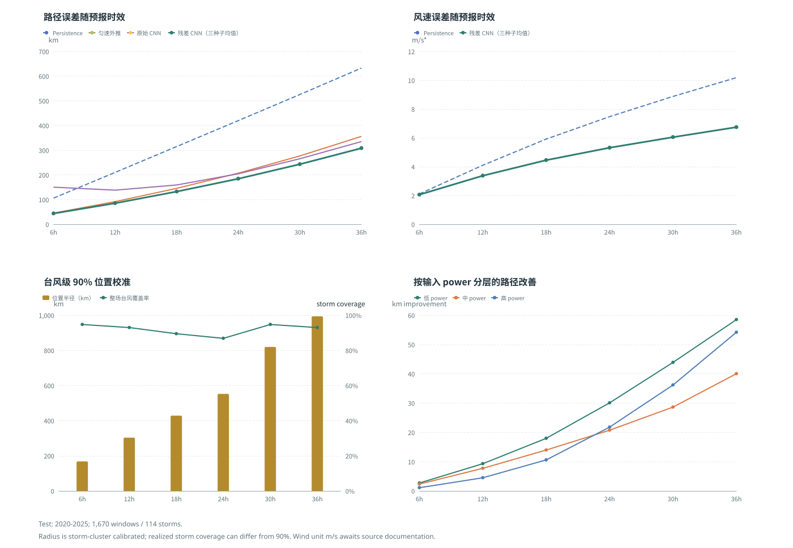

# 热带气旋 CNN 轨迹预测训练报告

生成日期：2026-09-28  
项目：CNN-Cesium  
数据指纹：`68fa166de12c638807258b67091c1bc996ba8c75a600ffdad013ece731a2cf9e`

## 1. 当前结论

当前最可靠的模型是“匀速先验 + CNN 残差修正”。在固定的 2020-2025 测试集上，它的轨迹 MAE 在 6、12、18、24、30、36 小时均优于匀速外推；但目前仍不能宣称全面优于所有基线，因为原始 CNN 在短时效表现较差，且项目尚未完成气象场融合、官方预报对比和概率锥体校准。


图 1：基于固定测试集结果的四面板汇总；强度分组是训练集阈值定义的探索性 `power` 分层。

## 2. 固定名单是怎么做的

1. `ml/prepare_dataset.py` 首次扫描原始台风文件，按台风编号的年份分组：1945-2016 为训练集，2017-2019 为验证集，2020-2025 为测试集。
2. 生成 `data/splits/storm_splits.json`，文件中保存每个台风编号到 `train`、`validation` 或 `test` 的唯一映射，以及名单数量和源数据指纹。
3. 后续重建数据集时优先读取这份名单，不重新随机抽样，因此同一个台风的所有时间窗口不会跨集合泄漏。
4. 预处理把源数据指纹、名单 SHA-256、三份 JSONL 样本 SHA-256 写入 `data/processed/manifest.json`。原始数据发生变化时会报错，必须人工确认后重新生成名单。
5. 训练只读取 `train.jsonl` 和 `validation.jsonl`；模型选优依据验证集损失。测试集 `test.jsonl` 只用于最终一次性评估，不能据测试结果反复调参。

当前固定结果：

| 集合 | 台风数 | 窗口样本数 | 年份 |
|---|---:|---:|---|
| train | 1,687 | 33,761 | 1945-2016 |
| validation | 94 | 926 | 2017-2019 |
| test | 154 | 1,670 | 2020-2025 |

## 3. 数据审计

- 有效台风轨迹：1,935；轨迹点：73,388。
- 经纬度无缺失、无重复时间戳、无非单调时间步。
- `speed` 和 `power` 各缺失 15 条，`pressure` 缺失 2,083 条。
- `move_dir`、`move_speed`、半径字段缺测比例较高，因此当前基线没有把它们伪装成可靠输入。
- 原始数据中没有真正接入的网格化气象场文件，`gridded_meteorology_files=0`。

### 3.1 来源与单位凭据

本地转换器 `ml/convert_cma_bst.py` 面向 CMA 年度最佳路径文本格式 `CHYYYYBST.txt`，并将源字段 `speed` 原值写入 JSON，没有做单位换算；仓库未保存原始文本、官方字段字典、下载链接/日期或许可说明。因此本报告和评估代码中的 `m/s` 是按 CMA 最佳路径字段惯例使用的单位假设，提交比赛前仍须附上数据源与字段定义的可追溯引用。若无法补到官方单位说明，应将风速 MAE 标注为“源数据 speed 单位”，不可无条件宣称 m/s。

## 4. 已完成的真实实验

训练设备为 CPU，输入为最近 4 个 6 小时轨迹点及 6 个特征：经度、纬度、风速、强度、经度增量、纬度增量；输出未来 6 个时刻，即 6-36 小时。测试样本数为 1,670。

### 4.1 轨迹 MAE（km）

| 预报时效 | Persistence | 匀速外推 | 原始 CNN | 残差 CNN |
|---:|---:|---:|---:|---:|
| 6h | 105.90 | 45.37 | 150.25 | **43.95** |
| 12h | 210.11 | 91.81 | 138.06 | **85.88** |
| 18h | 314.81 | 145.56 | 159.26 | **133.49** |
| 24h | 419.78 | 207.07 | 204.59 | **186.12** |
| 30h | 525.45 | 276.81 | 265.35 | **245.26** |
| 36h | 632.62 | 355.91 | 334.98 | **310.67** |

残差 CNN 相对匀速外推的轨迹 MAE 改善约为 3.1%、6.5%、8.3%、10.1%、11.4%、12.7%。这说明“物理启发的运动先验 + 学习残差”比直接让 CNN 从零回归位置更稳健。

### 4.2 风速 MAE（m/s）

残差 CNN 在 6-36 小时分别为 2.05、3.37、4.44、5.29、6.00、6.66；对应 Persistence 为 2.11、4.10、5.91、7.47、8.87、10.18。该结果支持残差模型的风速预测改进；分强度等级评估仍待补充，不确定性覆盖率见第 6.2 节。

### 4.3 轨迹特征消融（同初始化、同批次顺序）

在同一固定切分上，对完整特征、去强度（speed/power）、去运动增量（delta_lng/delta_lat）和仅位置四种输入做控制实验。每组最多 40 轮，验证损失早停（patience=8）；四组使用相同随机种子 2026、相同初始化和训练批次顺序，测试集均为 1,670 个样本。结果见 `artifacts/ablation/metrics_controlled.json`，数据指纹和固定名单 SHA-256 与本文一致。

| 时效 | 完整 Path MAE | 去强度 Path MAE | 去运动增量 Path MAE | 仅位置 Path MAE | 完整 Wind MAE | 去强度 Wind MAE | 仅位置 Wind MAE |
|---:|---:|---:|---:|---:|---:|---:|---:|
| 6h | 43.66 | 43.69 | 50.34 | 47.36 | 2.03 | 9.67 | 10.42 |
| 12h | 85.23 | 84.78 | 96.65 | 87.77 | 3.35 | 9.42 | 10.15 |
| 18h | 131.70 | 131.24 | 146.33 | 134.61 | 4.44 | 9.23 | 9.89 |
| 24h | 183.32 | 183.10 | 199.89 | 187.04 | 5.30 | 9.14 | 9.69 |
| 30h | 241.36 | 241.02 | 259.14 | 245.25 | 6.01 | 9.10 | 9.57 |
| 36h | 305.98 | 306.12 | 324.18 | 309.70 | 6.69 | 9.11 | 9.51 |

Path MAE 单位为 km，Wind MAE 单位为 m/s。去掉运动增量后路径 MAE 在六个时效均变差，增幅约 4.4%-15.3%；去掉强度特征后风速 MAE 明显变差，但路径 MAE 与完整模型接近。结论仅支持“运动增量对路径预测有帮助、强度输入对风速预测重要”，不能据此声称已融合风场或完成气象变量消融。完整模型已做三种子复核；各消融变体仍是单次训练，若要量化模块贡献的不确定性，应为消融也补充多种子实验。

### 4.4 三种子稳定性复核

为检查初始化敏感度，在相同固定切分和训练配置下评估 seed 2026、2027、2028。每个种子最多 60 轮、patience=10，均使用 CPU；2026 的最优轮次为 41，2027 为 59，2028 为 57。表中为三次测试结果的均值 ± 样本标准差（n=3），不是置信区间。

| 时效 | 路径 MAE（km） | 风速 MAE（m/s） | 匀速路径 MAE（km） | 路径误差改善 |
|---:|---:|---:|---:|---:|
| 6h | 43.70 ± 0.22 | 2.05 ± 0.01 | 45.37 | 3.7% |
| 12h | 85.43 ± 0.86 | 3.37 ± 0.04 | 91.81 | 7.0% |
| 18h | 132.40 ± 1.25 | 4.45 ± 0.04 | 145.56 | 9.0% |
| 24h | 184.46 ± 1.83 | 5.31 ± 0.09 | 207.07 | 10.9% |
| 30h | 243.06 ± 2.57 | 6.05 ± 0.13 | 276.81 | 12.2% |
| 36h | 308.17 ± 3.10 | 6.74 ± 0.15 | 355.91 | 13.4% |

三个种子的残差 CNN 在所有时效均低于匀速基线，且种子间路径 MAE 波动较小；这是对当前固定测试集的重复训练结果，不代表跨区域或跨数据源泛化。原始逐种子指标和日志分别保存在 `artifacts/residual/runs/20260927T121802Z/`、`artifacts/residual_seed_sensitivity/seed_2027/`、`artifacts/residual_seed_sensitivity/seed_2028/`。

### 4.5 按台风配对 Bootstrap

为避免 1,670 个重叠窗口被当成独立统计单位，对 114 场测试台风计算每场平均路径 MAE，再按台风配对重采样 10,000 次。下表给出“匀速误差 - CNN 误差”的平均改善及 95% bootstrap 区间（km）；每个训练种子独立计算，18 个区间下界均大于 0。

| 时效 | seed 2026 改善 [95% CI] | seed 2027 改善 [95% CI] | seed 2028 改善 [95% CI] |
|---:|---:|---:|---:|
| 6h | 1.91 [1.22, 2.62] | 2.31 [1.51, 3.16] | 2.46 [1.72, 3.22] |
| 12h | 7.93 [5.60, 10.35] | 8.85 [6.15, 11.76] | 9.05 [6.74, 11.49] |
| 18h | 15.94 [11.15, 20.89] | 17.93 [12.38, 23.74] | 16.53 [12.13, 21.25] |
| 24h | 26.79 [19.27, 34.70] | 28.93 [19.48, 38.48] | 27.70 [20.67, 35.33] |
| 30h | 40.38 [29.09, 52.33] | 42.87 [27.96, 57.55] | 41.95 [30.90, 53.52] |
| 36h | 56.14 [39.85, 73.39] | 58.69 [38.03, 79.16] | 57.58 [41.52, 73.94] |

这是固定 2020-2025 测试台风上的条件性配对区间，三个种子分别报告，不是跨年份、跨海盆或未来业务预报保证；台风等权估计也不同于第 4.1/4.4 节窗口等权 MAE。原始结果：`artifacts/residual/storm_bootstrap.json`。

### 4.6 按输入强度分层

全量数据没有统一可核验的官方强度单位映射，故不套用业务等级。使用训练集逐台风中位 `power` 的三分位阈值（10、12），按每个测试窗口预报起点的输入 `power` 分为低/中/高组；阈值只来自训练集。下表是三个种子各自台风等权 MAE 改善的均值（km），对应测试窗口/台风数分别为低组 784/103、中组 305/75、高组 581/55。同一台风可在不同预报起点进入不同组。

| 输入 power 组 | 6h | 12h | 18h | 24h | 30h | 36h |
|---|---:|---:|---:|---:|---:|---:|
| 低（≤10） | 2.7 | 9.3 | 18.0 | 30.1 | 43.9 | 58.5 |
| 中（10 < power ≤ 12） | 2.4 | 7.7 | 14.0 | 20.7 | 28.6 | 40.0 |
| 高（>12） | 1.1 | 4.5 | 10.6 | 21.8 | 36.2 | 54.2 |

低/中组 18 个种子-时效 bootstrap 区间下界均高于零；高组只有 2027 种子的 6h 区间跨零，其余 17 个组合下界高于零。该分层是模型输入特征的探索性分组，不是官方强度等级或分级预报验证；逐组样本数、区间和种子结果见 `artifacts/residual/storm_bootstrap.json`。

## 5. 12 天冲刺安排

| 时间 | 必做工作 | 验收产物 |
|---|---|---|
| 第1天 | 冻结名单、复核字段、备份当前指标 | `storm_splits.json`、`manifest.json` |
| 第2-3天 | 下载并整理 ERA5/公开气象场，完成时空插值 | 气象场样本覆盖率报告 |
| 第4-5天 | 加入海温、850hPa 风、海平面气压、湿度等特征 | 多源数据 JSONL/缓存 |
| 第6天 | 已完成轨迹输入特征消融；仍需训练轨迹-only、气象-only、融合模型 | `artifacts/ablation/metrics_controlled.json`；气象场消融待补 |
| 第7天 | 补充 Persistence、匀速、官方预报或公开预报产品对比 | 统一测试集对比表 |
| 第8天 | 已完成 MC Dropout + 台风聚类 conformal 位置半径；二维概率锥体仍待补 | `uncertainty_clustered.json`；整场覆盖率与半径表 |
| 第9天 | 生成概率锥体、误差随时效曲线、案例图 | PNG/SVG 图表 |
| 第10天 | 接入前端真实预测接口和历史回放 | 可运行演示 |
| 第11天 | 全链路验收、记录 CPU/GPU 推理耗时 | 验收日志 |
| 第12天 | 固化模型、整理答辩材料、只引用已验证数字 | 最终报告、演示视频 |

## 6. 尚未完成且不能虚构的内容

- 项目目录现已存在一份已完成元数据核验的原始 ERA5 GRIB 文件 `ERA5data/data.grib`：U/V 风分量，200/300/500/700/850 hPa，2025 年 00/06/12/18 UTC，区域 `45N-0N/100E-180E`，0.25 度规则网格。详细结果保存在 `ERA5data/metadata.json`。但尚未完成轨迹点时空插值、覆盖率审计和模型融合训练，因此仍不能视为已经融合网格气象场。
- 目前没有完成官方预报产品的同样本、同起报时刻对比。
- 已有按台风聚类校准的位置误差半径和测试覆盖率；仍未完成二维概率锥体/联合经纬度区域，也未报告完整区间评分。
- 已完成轨迹输入特征（强度、运动增量）消融；气象场特征消融仍未完成，因为当前没有接入网格气象场。

### 6.1 ERA5 接入状态

`ml/download_era5.py` 已具备按台风月份请求 ERA5 200/300/500/700/850 hPa 的 u/v 风场功能；已修复跨 180° 经线区域框过宽和整场风暴范围重复下载问题，并由 `ml/tests/test_download_era5.py` 的 3 项测试验证。当前 `ERA5data/data.grib` 已通过 `ml/inspect_era5_grib.py --verify`；下一步仍需完成轨迹点对齐、覆盖率审计和融合模型训练：

```powershell
cd D:\project\CNN-Cesium
python -m pip install cdsapi xarray netCDF4
python -m ml.download_era5 --year 2025 --limit 1
```

下载成功只代表拿到原始气象场；仍须实现轨迹点时空插值、缺测覆盖率审计、训练集统计量归一化和融合模型评估后，才可报告气象融合结果。

### 6.2 不确定性评估进展

直接 MC Dropout 区间偏窄，未校准逐坐标覆盖率约 14%-30%。旧版按窗口取分位数的校准假设窗口独立，不适合重叠轨迹窗口，现仅保留作历史记录，不作为主结论。新版按独立台风聚类：验证集 69 场台风；每个时效先对每场台风取窗口最大误差，再用有限样本 conformal 次序统计量取 90% 分位数。测试集有 114 场含有效窗口的台风。

| 时效 | 位置半径（km） | 测试窗口覆盖率 | 测试整场台风覆盖率 | 经纬度与风速同时覆盖的台风比例 |
|---:|---:|---:|---:|---:|
| 6h | 168.2 | 99.3% | 94.7% | 77.2% |
| 12h | 303.2 | 99.2% | 93.0% | 69.3% |
| 18h | 428.6 | 98.9% | 89.5% | 64.9% |
| 24h | 552.3 | 98.3% | 86.8% | 77.2% |
| 30h | 819.7 | 99.6% | 94.7% | 78.1% |
| 36h | 993.8 | 99.3% | 93.0% | 79.8% |

单位覆盖是所有窗口误差落在半径内的比例；整场覆盖要求该台风该时效的所有窗口均落在半径内。部分时效的整场实测覆盖低于 90%，且测试年份与校准年份不同，存在时间分布变化风险；半径也较宽。因此这只是当前样本上的聚类校准评估，不保证未来覆盖，也不等同于官方概率锥体。不能把 90% 标称水平说成测试集各时效均已达到 90%。若可视化，应注明校准单位、样本数、实测覆盖率；二维概率锥体仍需专门建模与验证。

气象场融合和官方预报对比必须在相同固定测试集、预报时效和评价指标下完成；没有生成对应结果前，答辩中只能表述为“计划补充”，不能写成已实现效果。

### 6.3 现有业务预报字段可用性审计

原始最佳路径 JSON 共 73,388 个观测点，其中 109 个点带有非空 `forecast` 字段，含 360 个未来位置；来源标签涉及中国、日本、韩国、美国、欧洲、菲律宾、中国香港和中国台湾，但没有字段字典、产品来源链接、机构/版本说明或许可信息，故暂不直接称为“官方预报”。按冻结的 2020-2025 测试台风筛查，找到 54 个预报起报点、171 个预报位置；其中 49 个起报点可由台风历史插值构造模型输入，158 个位置落在模型支持的 6-36 小时预报时效内，但只有 2 个位置能在最佳路径中核验，且这 2 个无法与可用输入历史同时配对，最终严格可比样本为 0。不能形成有统计意义的模型对比。

因此现有 `forecast` 字段只作为发现到的候选资料，不并入训练、不用于官方预报排名。补齐对照至少需要：可追溯的机构与产品版本、起报时间和有效时次、独立观测最佳路径覆盖，以及与本模型相同测试台风/时效的配对样本。可用 `python -m ml.audit_operational_forecasts --output artifacts/reports/operational_forecast_audit.json` 重跑只读审计；当前结果保存在 `artifacts/reports/operational_forecast_audit.json`，并绑定了数据指纹和冻结名单 SHA-256。

### 6.4 下一轮训练的外部依赖门槛

截至本报告复核时，本机未检测到 `data/era5/`、`cdsapi`、`xarray`、`netCDF4` 或 `~/.cdsapirc`，也没有配置 `CDSAPI_URL`/`CDSAPI_KEY`；因此尚不能开始 ERA5 下载或气象融合训练。下一步先由项目成员在 Copernicus Climate Data Store 注册并接受 ERA5 数据许可，在本机配置 API 凭据（不要把密钥提交到 Git 或粘贴到聊天），随后仅下载 1 场测试台风做小样本 smoke test。下载通过后再补齐字段插值、缺测覆盖审计、融合模型训练、固定测试集对照和相同预算消融；如果十二天窗口不足以完成，就将融合实验如实列为未完成，不用模拟数据代替。

## 7. 可复现实验命令

```powershell
cd D:\project\CNN-Cesium
.\.venv\Scripts\python.exe -m py_compile ml\models\residual_cnn.py ml\train_residual.py
.\.venv\Scripts\python.exe -m py_compile ml\train_ablation.py
.\.venv\Scripts\python.exe -m py_compile ml\evaluate_uncertainty.py
.\.venv\Scripts\python.exe -m ml.train_residual `
  --data-root data `
  --output-root artifacts\residual `
  --epochs 60 `
  --batch-size 256 `
  --device cpu

# Optional repeat runs for seed-sensitivity evaluation; each uses an isolated output directory.
.\.venv\Scripts\python.exe -m ml.train_residual --data-root data --output-root artifacts\residual_seed_sensitivity\seed_2027 --seed 2027 --epochs 60 --batch-size 256 --device cpu
.\.venv\Scripts\python.exe -m ml.train_residual --data-root data --output-root artifacts\residual_seed_sensitivity\seed_2028 --seed 2028 --epochs 60 --batch-size 256 --device cpu

# Storm-clustered conformal uncertainty evaluation (50 MC Dropout draws, reproducible seed).
.\.venv\Scripts\python.exe -m ml.evaluate_uncertainty --data-root data --checkpoint artifacts\residual\checkpoints\track_cnn_residual.pth --output artifacts\residual\uncertainty_clustered.json --samples 50 --seed 2026 --device cpu

# Storm-level paired bootstrap against the constant-velocity baseline.
.\.venv\Scripts\python.exe -m ml.evaluate_storm_bootstrap --data-root data --output artifacts\residual\storm_bootstrap.json --iterations 10000 --bootstrap-seed 2026 --device cpu

# Regenerate the SVG figure using the ECharts dependency already installed by the frontend.
node ml\plot_training_results.cjs
```

关键输出：

- 模型：`artifacts/residual/checkpoints/track_cnn_residual.pth`
- 测试指标：`artifacts/residual/runs/20260927T121802Z/test_metrics.json`
- 按窗口校准的旧版记录：`artifacts/residual/uncertainty_metrics.json`（不作为主结论）
- 按台风聚类校准：`artifacts/residual/uncertainty_clustered.json`
- 按台风配对 bootstrap：`artifacts/residual/storm_bootstrap.json`
- 图表：`artifacts/reports/training_results.svg`；生成器：`ml/plot_training_results.cjs`
- 控制特征消融：`artifacts/ablation/metrics_controlled.json`
- 固定名单：`data/splits/storm_splits.json`
- 数据审计：`data/processed/manifest.json`

## 8. 当前答辩表述

可以说：项目已经完成按台风编号隔离的数据集、可复现训练流程、传统基线和残差 CNN 的真实测试；残差 CNN 在当前测试集的 6-36 小时轨迹误差均低于匀速外推。

不能说：CNN 已经全面优于传统方法、已经融合完整气象场、已经优于官方预报，或已经完成概率锥体校准。这些结论需要后续实验文件和指标支持。
